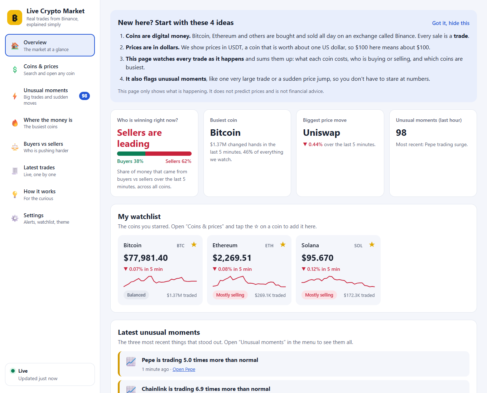
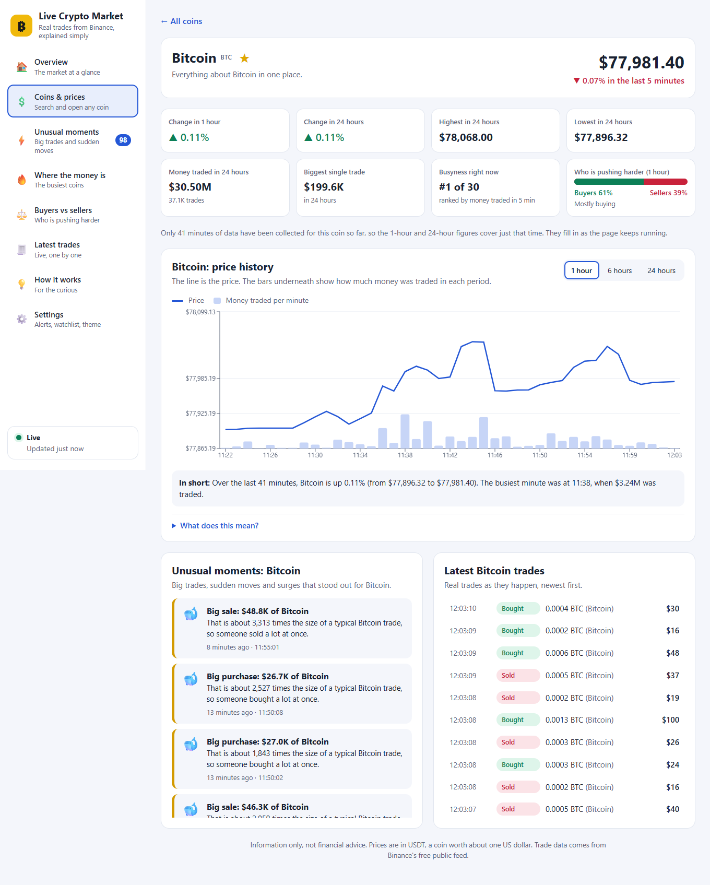
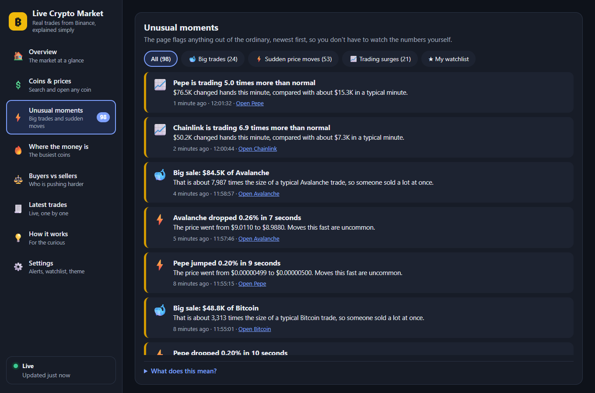
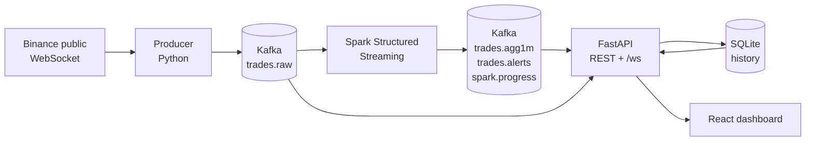

# Binance Live Trade Monitor

[](https://github.com/ab-rar-6024/binance-live-trade-monitor/actions/workflows/ci.yml)

Real-time crypto trade analytics that anyone can read. Live trades from Binance flow through **Kafka**, are analysed by
**Spark Structured Streaming**, served by a **Python (FastAPI)** backend and shown on a **React** dashboard that explains
itself in plain language.



It watches 30 coins (BTC, ETH, BNB, SOL, XRP, DOGE and 24 more, all quoted in USDT) and answers six questions:

| # | Question | How it is answered |
|---|----------|--------------------|
| 1 | What are the price and volume of each coin right now? | Spark: one-minute windows per coin (VWAP, open/high/low/close, volume, USD value) |
| 2 | Did someone make an unusually large trade? ("whale") | Spark: one trade far above that coin's recent norm (z-score of ln(USD), a ratio, and a USD floor) |
| 3 | Did a price just spike? | Spark: a move of 0.25% or more within 10 seconds (15 s cooldown) |
| 4 | Is trading abnormally busy? | Spark: this minute's USD volume against the median of the previous minutes (5x or more) |
| 5 | Which coins are hot? | API: ranking by USD traded over the last N minutes, with the change versus the N minutes before |
| 6 | Are buyers or sellers pushing harder? | Spark: taker-buy vs taker-sell USD per window |

## Highlights

- **Built to be understood.** Plain-English sentences instead of jargon ("Big purchase: $48.8K of Bitcoin, about 3,300 times
  a typical Bitcoin trade"), a first-visit guide, an explanation under every section, and no meaning carried by colour alone.
- **One page per section** in a sidebar: Overview, Coins & prices, Unusual moments, Where the money is, Buyers vs sellers,
  Latest trades, How it works, Settings. Every page and every coin has its own link.
- **A page for every coin** with 1-hour, 6-hour and 24-hour charts, 24-hour range and volume, who is buying vs selling,
  and that coin's own unusual moments and trades.
- **Alerts you notice:** optional pop-ups, system notifications and a sound for new unusual moments, filterable by type,
  severity, size and your watchlist. Search, sort and star coins; light, dark or follow-the-device theme.
- **Remembers its history.** Spark's results are stored in SQLite, so the dashboard keeps its memory when the API restarts.
- **Honest about itself:** the "How it works" page shows each stage of the pipeline with live numbers and measured delay.
- **Tested:** 62 backend tests, 32 frontend unit/component tests and 8 browser tests, run in CI.

| Coin page | Dark mode |
|-----------|-----------|
|  |  |

## How it works



- **Binance** needs no account, API key or card: the public market-data stream `data-stream.binance.vision` is used.
- **Kafka** is the durable buffer between stages, so any stage can restart and catch up. Single node, KRaft mode (no ZooKeeper).
- **Spark** does the work that needs memory over time: one-minute windows and the per-coin detectors
  (`applyInPandasWithState`, with the detector logic in plain Python in `backend/streaming/detectors.py` so it can be unit-tested).
- **FastAPI** keeps the latest picture in memory, rebuilt at start-up from SQLite plus whatever Kafka has that SQLite lacks,
  and pushes a snapshot to the browser every second over a WebSocket.
- **Measured delay** on a laptop-class PC: Binance trade to API about 60 ms; trade to Spark result about 1.7 s (median).

## Quick start

**Requirements:** Python 3.11 (the version used and tested; PySpark 3.4 and the pinned pandas 1.5 do not support 3.12+), Node 18+, a JDK 17 (Spark and Kafka run on Java; the Windows shim also needs `javac`).
Developed and tested on **Windows 11**. Nothing in the code is Windows-only except a workaround Spark needs there
(see [Windows notes](#windows-notes)), so Linux and macOS should work, but they have not been tried.

```bash
# 1. Python environment
python -m venv .venv
.venv/Scripts/pip install -r backend/requirements.txt     # on Linux/macOS: .venv/bin/pip

# 2. Frontend
cd frontend && npm install && cd ..

# 3. Kafka: downloads Apache Kafka 3.9.1 (checksum-verified), writes a single-node config, formats storage
.venv/Scripts/python scripts/setup_kafka.py

# 4. Run everything (Kafka, API, producer, Spark, dashboard) and wait until it is ready
.venv/Scripts/python scripts/dev.py start
```

Then open **http://localhost:5173**. The first start takes a minute or two (Spark downloads its Kafka connector jars,
checksum-verified, on first use). Other commands: `dev.py status`, `dev.py stop`, `dev.py restart`. Logs are in `logs/`.

If `JAVA_HOME` is not set, `dev.py` falls back to an Adoptium JDK 17 path on Windows; set `JAVA_HOME` if yours lives elsewhere.

## Tests

```bash
python -m pytest                      # 62 backend tests: detectors, parsing, hub, store, API, protections (no Kafka or Spark needed)
cd frontend
npm run build                         # strict TypeScript check + production build
npm test                              # 32 unit and component tests (Vitest)
npx playwright test                   # 8 browser tests against a mocked backend (uses installed Edge; E2E_BROWSER=chrome for Chrome)
```

## The dashboard

| Page | What it shows |
|------|---------------|
| Overview | A guide for newcomers, four headline answers, your watchlist, the latest unusual moments |
| Coins & prices | Every coin with price, 5-minute change, sparkline and buying/selling mood; search, sort, star |
| Coin page (`#/coin/BTCUSDT`) | Price history (1h / 6h / 24h), 24-hour stats, that coin's alerts and trades |
| Unusual moments | All alerts as plain sentences, filterable by kind and watchlist |
| Where the money is | Coins ranked by money traded, with "busier / quieter than before" |
| Buyers vs sellers | A tug-of-war bar for every coin |
| Latest trades | The live trade feed |
| How it works | The pipeline explained simply, with live numbers |
| Settings | Theme, alert preferences (pop-ups, sound, system notifications), the smallest big trade to show, watchlist |

Settings and the watchlist are stored in your browser only (`localStorage`); nothing is sent to a server.

## Tuning the alerts

`scripts/analyze_alerts.py` replays every trade still stored in Kafka through the same detector code Spark uses, once per
threshold setting, and reports how many alerts each setting would have produced and which coin would be noisiest.
It never touches the live pipeline.

On the first run (about 35 minutes of real trading across 30 coins) the original settings produced roughly **200 alerts an hour**,
with Bitcoin alone triggering 44 "big trades" an hour at a $25,000 floor and low-priced coins like PEPE dominating price
spikes. That is too noisy for a page meant to point out *rare* moments, so the defaults were raised to a $50,000 floor, a 0.25%
spike and a 5x surge, which gave about 60 an hour with no single coin dominating. That is a small sample, so re-run the script
after the stack has collected a day or more and adjust through environment variables:

| Variable | Default | Meaning |
|----------|---------|---------|
| `WHALE_MIN_USD` | 50000 | A big trade must be at least this many dollars |
| `WHALE_Z`, `WHALE_RATIO` | 4.0, 10 | ...and this far above that coin's typical trade (z-score of the log size, and size ratio) |
| `WHALE_MIN_HISTORY` | 30 | Trades a coin needs before its "typical" size is trusted |
| `SPIKE_PCT` | 0.25 | Price move (percent) within 10 seconds |
| `SURGE_RATIO` | 5.0 | This minute's volume versus the median recent minute |
| `SURGE_MIN_USD`, `SURGE_MIN_HISTORY` | 50000, 5 | Dollar floor, and minutes of history required |

## Configuration

| Variable | Default | Meaning |
|----------|---------|---------|
| `SYMBOLS` | 30 USDT pairs | Comma-separated Binance symbols to watch |
| `KAFKA_BOOTSTRAP` | 127.0.0.1:9092 | Kafka address |
| `TOPIC_PARTITIONS` | 3 | Partitions per topic |
| `DB_PATH` | data/market.db | SQLite history (windows kept 7 days, alerts 30 days) |
| `SPARK_CORES`, `SPARK_SHUFFLE_PARTITIONS` | 6, 2 | Small micro-batches favour few partitions |
| `API_HOST`, `API_PORT` | 127.0.0.1, 8100 | Where the API listens |
| `VITE_API_URL` | http://127.0.0.1:8100 | API address the dashboard calls (set when building the frontend) |

## API

Interactive docs at `http://127.0.0.1:8100/docs`.

| Endpoint | Returns |
|----------|---------|
| `GET /api/overview` | Price, 5-minute change, this minute's volume and buyer share for every coin |
| `GET /api/coin/{symbol}` | One coin: 5m/1h/24h change, 24-hour range and volume, buyer share, activity rank |
| `GET /api/series/{symbol}?minutes=60..1440&bucket=` | Candles from Spark's windows, merged into 1/5/15-minute points on long ranges |
| `GET /api/hot?minutes=5` | Coins ranked by USD traded, with change versus the previous period |
| `GET /api/pressure?minutes=5` | Buyer vs seller share per coin and overall |
| `GET /api/alerts?type=&symbol=&since=&limit=` | Detector alerts, newest first |
| `GET /api/stats/alerts?days=7` | Alert counts per day, coin and kind (from the history store) |
| `GET /api/trades?symbol=` | Most recent trades |
| `GET /api/system`, `/api/health`, `/api/config` | Pipeline health and measured latency; health summary; symbols and thresholds |
| `WS /ws` | A snapshot on connect, then a tick every second |

## Project layout

```
backend/common      settings, Kafka admin helpers
backend/producer    Binance WebSocket -> Kafka
backend/streaming   Spark jobs, the pure-Python detectors, Windows shim, connector-jar download
backend/app         FastAPI app, the Kafka-fed in-memory hub, SQLite store, request limits
backend/tests       pytest
frontend/src        React + Vite + TypeScript + Recharts
frontend/e2e        Playwright browser tests with a mocked backend
scripts             setup_kafka.py, dev.py (launcher), analyze_alerts.py
```

## Putting it online

This project is built for running on your own machine. If you expose it, know what it does and does not do:

- The API ships with a per-IP request limit (`API_RATE_LIMIT`, default 600 a minute), a cap on WebSockets per IP
  (`API_MAX_WS_PER_IP`), safe response headers, configurable CORS (`API_CORS_ORIGINS`), the option to switch the docs off
  (`API_DOCS=0`), and it only answers `GET`. Set `API_TRUST_PROXY=1` only when it sits behind your own reverse proxy,
  so the real client address can be read from `X-Forwarded-For`.
- **There is no login.** A token baked into a public single-page app is not a secret, so none is offered. If the data should not
  be public, put the dashboard and API behind a reverse proxy that does authentication (for example basic auth or OAuth).
- Serve over HTTPS, build the frontend with `VITE_API_URL` pointing at your API, and keep Kafka on `127.0.0.1`
  (its default here): the bundled broker has no authentication.
- Read the [data terms](#binance-data) first.

## Windows notes

- **No `winutils.exe`.** Spark streaming on Windows normally needs Hadoop's native `winutils.exe`. Instead of downloading a
  third-party binary, a tiny Java file system (`backend/streaming/hadoop_shim`, built with `javac` the first time) skips the
  permission calls Spark would make, and Spark is told to use it for local files and checkpoints.
- **Pinned versions.** PySpark 3.4 does not work with numpy 2 or pandas 2, so `requirements.txt` pins numpy 1.26, pandas 1.5,
  pyarrow 14.
- **Kafka log retention.** Windows cannot delete memory-mapped files that are open, which can crash a broker when it cleans up
  old segments. Retention is 72 hours with 128 MB segments, so cleanup is rare. If the broker ever stops on a deletion error,
  stop everything, delete `data/kafka-logs`, run `scripts/setup_kafka.py` again and start.
- **Stopping.** `dev.py stop` ends Kafka with a hard kill (Windows has no clean way to stop it from a script). Kafka recovers
  on the next start; this was tested.

## Limits and honesty

- This shows what happened. It does **not** predict prices and is **not** financial or trading advice.
- A "whale" here means "unusually large for that coin recently", not a known person or fund. A spike or surge is a statistical
  flag; the reason is not known.
- Detectors learn each coin's normal after start-up (30 trades for big trades, 5 minutes for surges), so alerts are quieter for
  the first minutes of a fresh run. 24-hour figures only cover the time the stack has been running.
- Only trade events are used (no order book). The buy/sell side is the *taker* side, taken from Binance's `m` flag.
- The clock of the machine running this can differ from Binance's by a second or more, so Binance-to-producer delay is not shown.
- `npm audit` reports 0 issues for the production dependencies; the test tooling (Vitest and friends) has advisories that only affect developers running tests, not the built dashboard.

## Binance data

The feed used here is Binance's public market-data stream, which needs no API key. What was checked: Binance's documentation says
the `data-stream.binance.vision` domain serves public market data only and needs no authentication, and that page lists no usage
limits. What could **not** be checked: Binance's full terms of use could not be retrieved while writing this, and Binance's separate
terms for its *historical datasets* (`data.binance.vision`) say commercial use needs a separate license. That is a different product,
but it shows Binance cares about data licensing. This project is intended for personal and educational use. If you want to
redistribute the data, run a public service on it, or use it commercially, read Binance's current terms and ask Binance first.

## License

[MIT](LICENSE). Binance and the coins shown are trademarks of their owners; this project is not affiliated with or endorsed by Binance.
